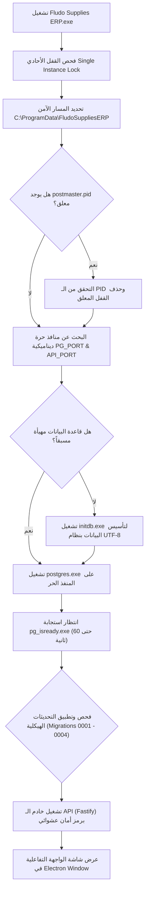

# دليل وهندسة قاعدة البيانات — Fludo Supplies ERP
## Specific Database Engine & The Portability Contract

> **ملف التوثيق الهندسي لقاعدة البيانات**  
> **الإصدار المعتمد:** v1.6.0  
> **تاريخ التوثيق:** 2026-11-24  

---

## 1. ما هي قاعدة البيانات المستخدمة تحديداً؟ (Specific Database Engine)

قاعدة البيانات المطبقة في نظام **Fludo Supplies ERP** هي:
### **PostgreSQL 18.4 (x64 Portable Embedded Engine)**

وليست SQLite أو قاعدة بيانات مبسطة في المتصفح، وليست خدمة ويندوز عامة (Windows Service):
* **محرك علائقي حقيقي (True Enterprise Relational Engine):** يدعم المعاملات الذرية الكاملة (ACID Transactions)، والتراجع التلقائي (Rollback) عند حدوث أي خطأ مالي.
* **إجراءات ومحفزات مخزنة (Stored Triggers & Functions):** تنفيذ العمليات الحسابية وتوليد الأكواد وحماية السجلات المعتمدة داخل الداتا بيز مباشرة عبر `PL/pgSQL`.
* **أعمدة محسوبة ومخزنة (Generated Columns):** مثل `net_total = lines_total + handling_fee` لضمان عدم وجود أي حسابات مالية على الواجهة الأمامية.
* **البحث العربي الذكي (Full Text Search):** استخدام إضافة `pg_trgm` مع دالة مخصصة `app.normalize_ar` لتطبيع الحروف العربية والبحث الفوري بدون تمييز بين الهمزات والتاء المربوطة.

---

## 2. كيف تعمل على هذا الجهاز أو أي جهاز ويندوز آخر؟ (How It Works on Any Device)

التطبيق مصمم ومبني وفق **"عقد عدم الكسر وقابلية النقل الشاملة" (Portability Contract)** بحيث يعمل على أي جهاز كمبيوتر يعمل بنظام **Windows 10 أو Windows 11 (64-bit)** فور تثبيته، **بدون أي تثبيتات مسبقة وبدون صلاحيات مسؤول (Administrator Rights).**

### 1) حزم ملفات المحرك مع التطبيق (Zero External Dependencies)
* يحتوي ملف التثبيت الموحد (`Fludo Supplies ERP Setup 1.6.0.exe`) على حزمة تشغيل PostgreSQL المحمولة بالكامل (`pgsql/bin`, `pgsql/lib`, `pgsql/share`).
* تم تضمين مكتبات التشغيل الأساسية (Visual C++ Redistributable DLLs مثل `vcruntime140.dll` و `msvcp140.dll` و `ucrtbase.dll`) داخل مجلد التطبيق، مما يمنع رسائل الخطأ الشهيرة "VCRUNTIME140.dll is missing" على الأجهزة الجديدة أو غير المحدثة.

### 2) التغلب على مشكلة أسماء المستخدمين العربية (Safe ASCII Path)
* **المشكلة الشائعة في ويندوز:** محرك PostgreSQL (وتحديداً أداة `initdb.exe`) يفشل في العمل إذا كان اسم حساب الويندوز يحتوي على حروف غير لاتينية (مثل: `C:\Users\عبد الرحمن\...`).
* **الحل الهندسي المطبق:** يقوم التطبيق تلقائياً بعزل قاعدة البيانات داخل مسار ASCII نظامي قياسي ومتاح لكافة المستخدمين:
  ```text
  C:\ProgramData\FludoSuppliesERP\data
  ```
  وفي حال عدم توفره، يتم استخدام المسار القصير بنظام 8.3 (Windows Short Path)، مما يضمن عدم حدوث أي عطل على أي جهاز بغض النظر عن لغة الويندوز أو اسم المستخدم.

### 3) التوزيع الديناميكي للمنافذ (Zero Fixed Ports)
* **المشكلة الشائعة:** حجز المنفذ الافتراضي `5432` بواسطة برامج أخرى أو قواعد بيانات سابقة مما يسبب خطأ "Port already in use".
* **الحل الهندسي المطبق:** التطبيق **لا يستخدم أي منفذ ثابت نهائياً**. عند بدء التشغيل، يطلب التطبيق من نواة نظام التشغيل (OS Kernel) منفذاً عشوائياً فارغاً عبر تقنية `net.createServer(0)`.
* يتم ربط محرك PostgreSQL حصرياً بعنوان الاسترجاع الداخلي الآمن `127.0.0.1` على هذا المنفذ الحر، ومعه خادم الـ API على منفذ حر آخر.

### 4) دورة التهيئة الأولى التلقائية (Auto-Init & Migration Pipeline)
عند تشغيل البرنامج لأول مرة على أي جهاز نظيف:
1. يكتشف التطبيق عدم وجود ملف `PG_VERSION` داخل مجلد البيانات.
2. يتم تشغيل `initdb.exe` صامتاً مع تشفير `UTF-8` ومستخدم المالك `erp_owner`.
3. يتم تشغيل المحرك كـ Child Process خفي في الخلفية.
4. يتم انتظار جاهزية المحرك عبر أداة `pg_isready.exe` (مع مهلة فحص تصل إلى 60 ثانية).
5. يتم إنشاء قاعدة بيانات `fludo_erp` عبر `createdb.exe`.
6. يطبق التطبيق ملفات الترحيل الهيكلية بالتسلسل:
   - `0001_initial.sql` (الجداول الأساسية، الحسابات، قيود اليومية، التريجرات).
   - `0002_fix_constraints_and_search.sql` (إضافة البحث العربي والقيود المحسنة).
   - `0003_comprehensive_schema_update.sql` (الـ Views الموحدة، كروت لوحة التحكم، تسلسلات الأكواد).
   - `0004_figjam_overhaul.sql` (جداول الفروع، حركات الخزينة، سجلات الطباعة، وجدول الحجوزات).

### 5) معالجة الانهيارات ومسح الأقفال القديمة (Crash Recovery & Stale Lock Handler)
* إذا تم إيقاف تشغيل الكمبيوتر فجأة أو انقطاع الكهرباء، يترك PostgreSQL ملف قفل باسم `postmaster.pid`.
* عند الإقلاع التالي، يقوم التطبيق بفحص هذا الملف: إذا كان رقم العملية (PID) القديم غير موجود في النظام، يقوم التطبيق بحذف الملف فوراً وإعادة تشغيل المحرك بسلاسة دون الحاجة لتدخل يدوي.

### 6) الإغلاق الآمن وحفظ البيانات (Graceful Shutdown)
* عند قيام المستخدم بإغلاق البرنامج، يلتقط نظام Electron حدث `before-quit` ويرسل أمر `pg_ctl stop -m fast`.
* يضمن هذا الأمر كتابة كافة سجلات التعديل (WAL - Write Ahead Logging) وحفظها على القرص الصلب قبل إنهاء العملية.

---

## 3. مخطط المعمارية والتشغيل (Architecture Flowchart)



---

## 4. مقارنة العمل بين جهاز التطوير وأي جهاز عميل

| وجه المقارنة | على جهازك الحالي (Dev Environment) | على أي جهاز عميل (Client Windows PC) |
| :--- | :--- | :--- |
| **مصدر المحرك** | ملفات PostgreSQL 18 المثبتة أو المنسوخة | محرك PostgreSQL 18 المحمول المدمج داخل حزمة الـ Setup |
| **مسار البيانات** | `C:\ProgramData\FludoSuppliesERP\data` | `C:\ProgramData\FludoSuppliesERP\data` |
| **المنفذ المستخدم** | منفذ حر يتحدد تلقائياً عند التشغيل | منفذ حر يتحدد تلقائياً عند التشغيل |
| **طريقة التثبيت** | سطر الأوامر / scripts | نقرة مزدوجة على `Fludo Supplies ERP Setup 1.6.0.exe` |
| **الاعتماد على الإنترنت** | غير مطلوب نهائياً (Offline 100%) | غير مطلوب نهائياً (Offline 100%) |
| **صلاحيات المسؤول (Admin)** | غير مطلوبة للتشغيل اليومي | غير مطلوبة للتشغيل اليومي |
| **الأمان** | مربوط بـ `127.0.0.1` مع رمز حماية مشفر | مربوط بـ `127.0.0.1` مع رمز حماية مشفر |

---

## 5. النسخ الاحتياطي واستعادة البيانات (Backup & DataPort)

لحماية بيانات العميل من أي تلف بنظام الويندوز أو تغيير الجهاز:
1. **النسخ الاحتياطي الكامل (SQL Dump):** متاح من صفحة الإعدادات بنقرة زر واحدة، ويولد ملف SQL كامل يحتوي على كل السجلات والجداول.
2. **النسخ الاحتياطي الجدولي (Excel Workbook):** تصدير واستيراد البيانات بصيغة إكسيل مع الحفاظ التام على أرقام وحسابات العملاء والموردين والأصناف.
3. **النسخ اليدوي المباشر:** يمكن للعميل أو الفني نسخ مجلد `C:\ProgramData\FludoSuppliesERP\data` بالكامل ونقله لأي جهاز آخر ليعمل النظام فوراً بنفس بياناته.
