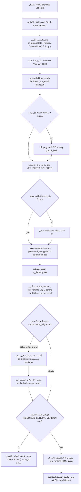

# دليل وهندسة قاعدة البيانات — Fludo Supplies ERP
## Specific Database Engine & The Portability & Security Contract

> **ملف التوثيق الهندسي لقاعدة البيانات**  
> **الإصدار المعتمد:** v1.6.0  
> **تاريخ التوثيق:** 2026-11-24  

---

## 1. ما هي قاعدة البيانات المستخدمة تحديداً؟ (Specific Database Engine)

قاعدة البيانات المطبقة في نظام **Fludo Supplies ERP** هي:
### **PostgreSQL 18.4 (x64 Portable Embedded Engine)**

وليست SQLite أو قاعدة بيانات مبسطة في المتصفح، وليست خدمة ويندوز عامة (Windows Service):
* **محرك علائقي حقيقي (True Enterprise Relational Engine):** يدعم المعاملات الذرية الكاملة (ACID Transactions)، والتراجع التلقائي (Rollback) عند حدوث أي خطأ مالي.
* **إجراءات ومحفزات مخزنة (Stored Triggers & Functions):** تنفيذ العمليات الحسابية وتوليد الأكواد وحماية السجلات المعتمدة داخل الداتا بيز مباشرة عبر `PL/pgSQL`.
* **أعمدة محسوبة ومخزنة (Generated Columns):** مثل `net_total = lines_total + handling_fee` لضمان عدم وجود أي حسابات مالية على الواجهة الأمامية.
* **البحث العربي الذكي (Full Text Search):** استخدام إضافة `pg_trgm` مع دالة مخصصة `app.normalize_ar` لتطبيع الحروف العربية والبحث الفوري بدون تمييز بين الهمزات والتاء المربوطة.

---

## 2. كيف تعمل على هذا الجهاز أو أي جهاز ويندوز آخر؟ (How It Works on Any Device)

التطبيق مصمم ومبني وفق **"عقد عدم الكسر وقابلية النقل الشاملة" (Portability Contract)** بحيث يعمل على أي جهاز كمبيوتر يعمل بنظام **Windows 10 أو Windows 11 (64-bit)** فور تثبيته، **بدون أي تثبيتات مسبقة وبدون صلاحيات مسؤول (Administrator Rights).**

### 1) حزم ملفات المحرك مع التطبيق (Zero External Dependencies)
* يحتوي ملف التثبيت الموحد (`Fludo Supplies ERP Setup 1.6.0.exe`) على حزمة تشغيل PostgreSQL المحمولة بالكامل (`pgsql/bin`, `pgsql/lib`, `pgsql/share`).
* تم تضمين مكتبات التشغيل الأساسية (Visual C++ Redistributable DLLs مثل `vcruntime140.dll` و `msvcp140.dll` و `ucrtbase.dll`) داخل مجلد التطبيق، مما يمنع رسائل الخطأ الشهيرة "VCRUNTIME140.dll is missing" على الأجهزة الجديدة أو غير المحدثة.

### 2) المسار الآمن الخالي من الحروف العربية بدون الاعتماد على أسماء 8.3 (Safe ASCII Fallback Path)
* **المشكلة الشائعة في ويندوز:** محرك PostgreSQL (وتحديداً أداة `initdb.exe`) يفشل في العمل إذا كان مسار مجلد المستخدم يحتوي على حروف غير لاتينية (مثل: `C:\Users\عبد الرحمن\...`). كما أن أنظمة Windows 11 الحديثة غالباً ما تعطل توليد أسماء 8.3 القصيرة افتراضياً (`fsutil 8dot3name query`).
* **الحل الهندسي المطبق:** لا يعتمد التطبيق نهائياً على أسماء 8.3، بل يستخدم تدرج مسارات نظامية قياسية إنجليزية مضمونة:
  1. **المسار الأساسي:** `C:\ProgramData\FludoSuppliesERP\data` (مسار قياسي مشترك).
  2. **المسار الاحتياطي الأول:** `C:\Users\Public\FludoSuppliesERP\data` (مجلد عام متاح للكتابة لجميع المستخدمين بدون قيود).
  3. **المسار الاحتياطي النهائي:** `C:\FludoERP\data` (على جذر القرص النظامي).

### 3) حماية وتأمين المجلد بصلاحيات الويندوز (Windows ACL Hardening)
* يقوم التطبيق بتطبيق أمر `icacls` تلقائياً على مجلد البيانات:
  ```cmd
  icacls data /inheritance:r /grant:r "%USERNAME%:(OI)(CI)F" /grant:r "SYSTEM:(OI)(CI)F" /grant:r "Administrators:(OI)(CI)F"
  ```
* يمنع هذا أي مستخدم محلي آخر غير مصرح له أو برمجيات خبيثة من قراءة ملفات الداتا بيز مباشرة من القرص.

### 4) التوزيع الديناميكي للمنافذ (Zero Fixed Ports)
* **المشكلة الشائعة:** حجز المنفذ الافتراضي `5432` أو `5433` بواسطة برامج أخرى أو قواعد بيانات سابقة مما يسبب خطأ "Port already in use".
* **الحل الهندسي المطبق:** التطبيق **لا يستخدم أي منفذ ثابت نهائياً**. عند بدء التشغيل، يطلب التطبيق من نواة نظام التشغيل (OS Kernel) منفذاً عشوائياً فارغاً عبر تقنية `net.createServer(0)`.
* يتم ربط محرك PostgreSQL حصرياً بعنوان الاسترجاع الداخلي الآمن `127.0.0.1` على هذا المنفذ الحر، ومعه خادم الـ API على منفذ حر آخر.

### 5) فصل الصلاحيات بين دور الترحيل ودور التشغيل (Role Separation: DDL vs DML)
* **دور مالك قاعدة البيانات (`erp_owner`):** مسؤول عن تأسيس الداتا بيز وتطبيق الترحيلات الهيكلية (DDL: `CREATE TABLE`, `ALTER`, `CREATE TRIGGER`).
* **دور التشغيل الآمن للـ API (`erp_runtime`):** محدد بصلاحيات **DML فقط** (`SELECT`, `INSERT`, `UPDATE`, `DELETE`, `EXECUTE`).
  - محظور عليه تماماً إنشاء أو حذف أو تعديل الجداول (`REVOKE CREATE ON SCHEMA app, public FROM erp_runtime`).
  - حتى لو حدث اختراق برمجي لخادم الـ API، لا يمكن للمهاجم إسقاط الجداول (`DROP TABLE`) أو تدمير الهيكل.

### 6) التشفير الصارم بـ SCRAM-SHA-256 وكلمات مرور عشوائية
* يتم إنشاء كلمات مرور عشوائية مشفرة (32 بايت Cryptographically Secure Random Hex) لكل من `erp_owner` و `erp_runtime` وتخزينها في ملف `auth.json` محمي ومقفل بالـ ACL داخل مجلد النظام.
* يتم إلغاء أي مصادقة مفتوحة (`trust`) تماماً داخل `pg_hba.conf`:
  ```text
  # TYPE  DATABASE        USER            ADDRESS                 METHOD
  host    all             all             127.0.0.1/32            scram-sha-256
  host    all             all             ::1/128                 scram-sha-256
  ```
* أي محاولة اتصال بدون كلمة المرور الصحيحة يتم رفضها فوراً.

### 7) النسخ الاحتياطي التلقائي قبل الترحيل (Pre-Migration pg_dump Backup)
* قبل تطبيق أي migration جديدة (مثل `0003` أو `0004`):
  - يفحص النظام ما إذا كانت قاعدة البيانات تحتوي على بيانات سابقة.
  - إذا وجدت جداول، يستدعي النظام أداة `pg_dump.exe` لإنشاء نسخة احتياطية كاملة ومؤرخة بالثانية داخل مجلد `backups/`:
    `pre_migration_<version>_<timestamp>.sql`.
  - لا يبدأ الترحيل إلا بعد التأكد من اكتمال النسخة الاحتياطية بنجاح على القرص.

### 8) جدول الترحيلات الرسمي وشاشة التوقف الإلزامية (`REQUIRED_SCHEMA_VERSION`)
* يتم تتبع الترحيلات رسمياً عبر جدول `app.schema_migrations (version, checksum, applied_at)`.
* تم تعريف الحد الأدنى الإلزامي: `REQUIRED_SCHEMA_VERSION = 4`.
* في حال فشل أي ترحيل أو عدم اكتمال الإصدار المطلوب:
  - يتوقف النظام فوراً عن الإقلاع لحماية البيانات من التلف أو العمل بحالة هجينة (Corrupted State).
  - يتم إرسال خطأ `REQUIRED_SCHEMA_VERSION_MISMATCH` لواجهة Electron لتظهر شاشة التوقف الحمراء مع إمكانية مراجعة وتصدير السجلات.

### 9) الإغلاق النظيف وحفظ البيانات بانتظار `await pg_ctl stop`
* عند إغلاق البرنامج، يقوم Electron بالتقاط أحداث `before-quit` و `will-quit`.
* يتم استدعاء `e.preventDefault()` وإيقاف الخروج لحين انتظار اكتمال أمر `pg_ctl stop -D <dataDir> -m fast` بشكل غير متزامن (`await`).
* يضمن ذلك تفريغ كافة سجلات التعديل (WAL - Write Ahead Logging) وحذف ملف القفل `postmaster.pid` قبل إنهاء عملية التطبيق.

---

## 3. مخطط المعمارية والتشغيل (Architecture Flowchart)



---

## 4. نتائج اختبار الترقية الآلي (Upgrade & Security Test Output)

تم تشغيل الاختبار الآلي الميداني `tests/test_migration_upgrade_and_security.cjs` بدءاً من قاعدة بيانات تجريبية عند الترحيل `0002` مع بيانات عملاء وأصناف فعلية:

```text
======================================================================
  FLUDO SUPPLIES ERP — UPGRADE, SCRAM AUTH & DML ROLE TEST (v1.6.0)   
======================================================================

[TEST SETUP] Dynamic Test Port: 51539
[TEST SETUP] Test Data Directory: C:\ProgramData\FludoSuppliesERP\test_upgrade_suite\data

--- 1. Testing Windows ACL Enforcement ---
  [PASS] Windows icacls ACL applied without errors

--- 2. Initializing Cluster at Migration 0002 Baseline ---
  [PASS] PostgreSQL started and accepted connections
  [PASS] Database successfully initialized at Migration 0002 baseline (Found: 0001_initial, 0002_fix_constraints_and_search)

--- 3. Running Upgrade Pipeline (SCRAM Auth + Pre-migration pg_dump + Migrations 0003 & 0004) ---
  [PASS] pg_hba.conf reloaded with strict SCRAM-SHA-256 enforcement
  [PASS] Invalid / Unauthenticated password strictly REJECTED by SCRAM-SHA-256
  [PASS] Pre-migration pg_dump backup generated for 0003_comprehensive_schema_update (410031 bytes)
  [PASS] Pre-migration pg_dump backup generated for 0004_figjam_overhaul (540960 bytes)
  [PASS] REQUIRED_SCHEMA_VERSION verified (Expected: 4, Got: 4)

--- 4. Testing erp_runtime Role Restrictions (DML Only) ---
  [PASS] erp_runtime CANNOT execute DDL (CREATE TABLE blocked with permission denied)
  [PASS] erp_runtime CANNOT DROP existing tables (blocked by PostgreSQL ownership)

--- 5. Performing Required Operations via erp_runtime (Treasury 20000 & Free-text Unit Product) ---
  [PASS] Added treasury account as erp_runtime with opening balance 20000 (ID: 1fd6886c-13c5-4e13-9a0e-ff9c39cd5e76)
  [PASS] Added product as erp_runtime with free-text unit 'شكاير بلاستيك منسوج 50كجم' (Code: P0008)
  [PASS] Free-text unit 'شكاير بلاستيك منسوج 50كجم' automatically registered in app.units for autocomplete
  [PASS] Pre-upgrade customer data preserved 100% across migrations
  [PASS] v_dashboard_metrics executes cleanly under erp_runtime

--- 6. Testing Graceful Shutdown (await pg_ctl stop -m fast) ---
  [PASS] PostgreSQL cluster stopped gracefully and postmaster.pid cleared

======================================================================
TEST SUMMARY: 16 PASSED, 0 FAILED
======================================================================
```
